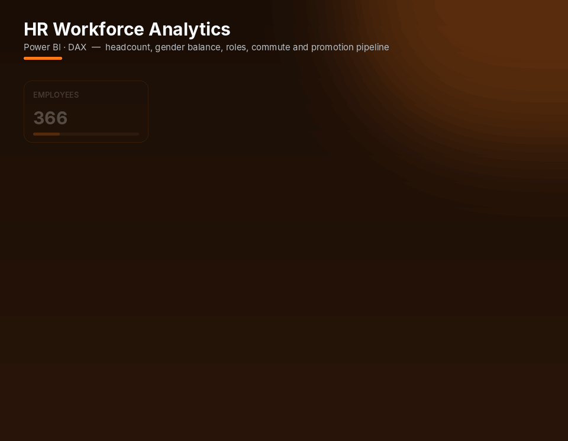
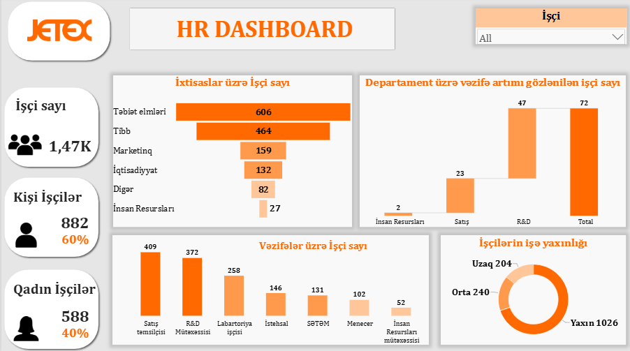

# 👥 HR Workforce Analytics Dashboard

 

*A one-page HR dashboard (in Azerbaijani) that gives management an instant picture of headcount, gender balance, departments, positions, commute distance and promotion pipeline.*

## 📸 Dashboard

🔍 View full-resolution static screenshot

 

---

## ❓ Business questions

- How many employees does the company have, and what is the gender split?
- How is headcount distributed across departments and positions?
- How far do employees live from the workplace?
- How many employees are expected to be promoted?

## 🗂 Data

Employee-level HR data — **department, position, education field, gender, distance to work, promotion expectation**.

## 📊 What's inside

- **KPI cards** — total employees, male / female count and %, expected promotions
- **Distance to work** (near / medium / far) — donut chart
- Headcount by **field of study** (funnel), **position** (column) and **expected promotions by department** (waterfall)
- **Employee slicer** and custom icons for a clean, management-ready layout

## 🔢 Headline KPIs

| Employees | Male | Female | Expected promotions |
|:-:|:-:|:-:|:-:|
| **1,470** | **882 (60%)** | **588 (40%)** | **72** |

## 💡 Key insights

- Most employees have a background in **Natural Sciences (606)** and **Medicine (464)**.
- **Sales representatives (409)** and **R&D specialists (372)** are the largest roles.
- Of the **72** employees expected to be promoted, **47** are in **R&D** and **23** in **Sales**.
- **70%** of employees (1,026) live **close** to the workplace; only 204 live far away.

## 🧠 Skills demonstrated

- Dashboard design and visual storytelling for HR
- DAX measures for counts and percentages
- Report localized in Azerbaijani for local stakeholders

---

## 🚀 How to open

1. Install [Power BI Desktop](https://www.microsoft.com/power-platform/products/power-bi/desktop) (free).
2. Download **`hr-workforce-analytics-dashboard.pbix`** from this repository.
3. Open it in Power BI Desktop and interact with the slicers and visuals.

---

Built by <a href="https://github.com/Ali-Isa-Ashrafli"><b>Ali Isa Ashrafli</b></a> · Data Analyst · Baku, Azerbaijan 
⭐ If you find this project useful, consider giving it a star!

